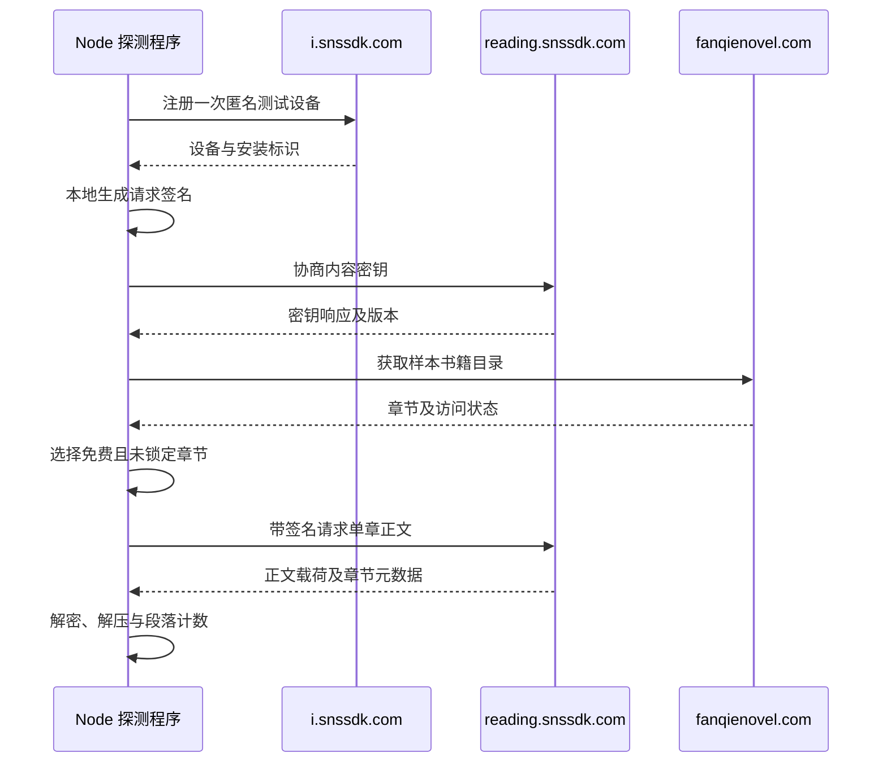
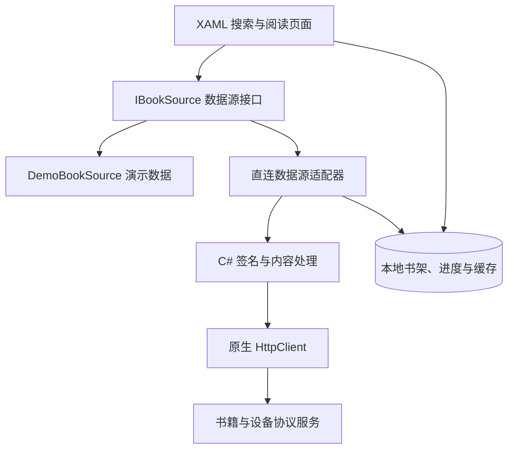

# Windows 10 Mobile 番茄小说客户端技术可行性报告

_基于 fanqie-assistant 源码审阅、原生移植与手机测试 · 更新于 2026-10-20 · 版本 1.3_

实施进展已更新至第 10 节：Lumia 950 上的原生搜索、详情、目录、免费正文、翻章和重启继续阅读均已通过。核心可行性阶段已完成。第 1—9 节保留最初协议研究阶段的结果与判断。

---

| 文档属性 | 内容 |
| --- | --- |
| 项目 | Fanqie Reader for Windows 10 Mobile |
| 目标设备 | Lumia 950 / Lumia 950 XL，ARM32 |
| 验证阶段 | UWP 手机完整阅读链路及问题回归已验证，原型版本 0.4.0 |
| 研究对象 | fanqie-assistant 0.0.6 |
| 源码提交 | `b62ec5dbe6149a93bca249949549c805ac7da424` |
| 验证日期 | 2026-10-19，北京时间 |
| 文档依据 | 固定版本源码、探测脚本、已保存的 JSON 指标 |

## 📋 1. 摘要与技术结论

本项目计划开发一款 Lumia 原生小说阅读客户端，由手机独立完成搜索、书籍详情、章节目录与正文获取。本轮以开源项目 fanqie-assistant 为研究对象，验证其数据链路能否脱离桌面浏览器和 Android 运行环境。

验证结果支持推进 **UWP 原型开发**：在 Windows PC / Node.js 环境中，已完成本地签名、匿名设备注册、内容密钥协商，以及一个免费且未锁定章节的请求、解密和解压。搜索、详情、目录请求同样成功。实际探测没有依赖常驻 Android 设备、自建中转服务器或远程签名服务。证据见[接口探测记录](../research/fanqie-probe-results.json)和[免费正文验证记录](../research/fanqie-free-content-results.json)。

| 判断维度 | 当前结论 | 证据层级 |
| --- | --- | --- |
| 独立实现网络协议 | 已在 PC 上跑通 | 实测 |
| 获得可读免费正文 | 一个样本章节成功 | 实测 |
| 将协议移植至 C# | 有明确实现路径 | 工程推断 |
| Lumia 独立联网阅读 | 尚未验证 | 待真机测试 |
| 多书籍、跨日稳定性 | 尚未验证 | 待扩大样本 |
| 接口与内容使用授权 | 尚未确认 | 待单独核实 |

当前适合进入“原生协议层移植与真机验证”阶段；现有证据尚不足以认定已具备稳定的 Windows 10 Mobile 阅读客户端或覆盖全书库的正文源。

## 🎯 2. 目标、范围与判定方法

### 2.1 目标系统约束

依据[项目上下文](../CODEX_PROJECT_CONTEXT.md)，客户端采用 C#、UWP、XAML、原生 HTTP 请求和本地缓存。初始工具链基线为 Visual Studio 2017、Windows 10 SDK 14393，重点验证 ARM32 真机。书架、阅读进度、缓存、字号和夜间模式属于后续应用层工作。

本轮的核心问题是：**正文链路是否具有可移植的独立客户端实现方式**。搜索与目录成功仅视为辅助证据，正文必须完成实际解码，才能确认本次协议链路跑通。

### 2.2 研究范围

| 纳入本轮 | 留待后续 |
| --- | --- |
| 源码请求链路与依赖审阅 | UWP UI 与阅读交互 |
| 本地签名与合成内容测试 | ARM32 构建、部署与性能 |
| 匿名搜索、详情、目录探测 | Lumia 当前证书与 TLS 兼容性 |
| 一次匿名设备与密钥初始化 | 设备和密钥的跨日复用 |
| 一个免费章节的解密与解压 | 多本书籍、连续章节及内容覆盖率 |
| 初步移植方案 | 平台接口与小说内容使用授权 |

批量正文、漫画、听书、账号同步、评论和付费内容均不属于此次验证范围。上游初始化中的会员激活和失效后的设备替换逻辑未被调用。

### 2.3 证据层级

本报告将“源码事实”“运行实测”和“工程推断”分开表达。源码事实证明某种实现存在；实测证明特定时间、环境和样本下的行为；工程推断用于提出移植方案，不作为真机成功的替代证据。

## 🔍 3. 研究对象与协议架构

### 3.1 固定版本与运行依赖

研究对象为 naiyQAQ/fanqie-assistant，package.json 版本为 0.0.6，固定提交时间为 2026-09-19 23:51:05 +08:00。它是面向番茄网页的 TypeScript 用户脚本，界面使用 Vue，并使用 Tampermonkey 的网络、存储等 API。构建配置还引用 Moment、JSZip 的 CDN 资源。[^1]

本轮未运行完整用户脚本，也未安装其 npm 依赖；[探测脚本](../research/probe-fanqie.mjs)通过 Node 的模块解析适配直接加载上游算法，并以原生 fetch 替代必要的请求入口。这一方法验证的是协议与算法层，不包含浏览器界面和用户脚本管理器。

### 3.2 请求目标与功能分工

| 功能 | 主机 | 路径 | 本轮状态 |
| --- | --- | --- | --- |
| 搜索 | `fanqienovel.com` | `/reading/bookapi/search/tab/v` | 成功 |
| 书籍详情 | `reading.snssdk.com` | `/reading/bookapi/detail/v` | 成功 |
| App 目录 | `reading.snssdk.com` | `/reading/bookapi/directory/all_items/v` | 成功 |
| 网页目录 | `fanqienovel.com` | `/api/reader/directory/detail` | 成功 |
| 单章正文 | `reading.snssdk.com` | `/reading/reader/full/v` | 免费样本成功 |
| 网页正文 | `fanqienovel.com` | `/api/reader/full` | 本次为空响应 |
| 设备注册 | `i.snssdk.com` | `/service/2/device_register/` | 一次成功 |
| 密钥协商 | `reading.snssdk.com` | `/reading/crypt/registerkey` | 一次成功 |

接口映射可在上游请求层、业务层和设备模块中定位。[^2][^3][^4] 本次所有业务请求均直接发往表中主机，没有使用第三方正文代理。上游另有 `jxbhmy.com` 备用通道，本轮没有测试，也没有将其纳入可行性结论。

### 3.3 免费正文验证时序

下图对应新匿名设备这一轮测试：先完成设备与密钥初始化，再从网页目录选取免费且未锁定的章节。



上游签名由本地 Argus / Ladon 等实现生成；正文处理使用 AES-CBC，并按返回状态解压，输出 HTML 字符串或 JSON。[^4][^5] 在已审阅的核心链路中，没有发现必须调用 Android APK、Xposed、原生 `.so` 或远程 unidbg 的运行路径。`unidbgconfig.ts` 在该链路中承担参数配置作用。

## 🧪 4. 验证环境与执行方法

### 4.1 环境与样本

| 项目 | 实际配置 |
| --- | --- |
| 执行环境 | Windows PC，PowerShell |
| 运行时 | Node.js `v24.19.0` |
| 第一轮记录起始时间 | 2026-10-19 15:08:05.989 +08:00 |
| 新设备记录起始时间 | 2026-10-19 15:10:12.850 +08:00 |
| 样本书籍 | 《部族荣光》 |
| `book_id` | `7069948840148732967` |
| `item_id` | `7069952706521236001` |
| 正文样本规模 | 1 本书中的 1 个章节 |

书籍来自官网详情页。[^6] 测试程序从实时目录选择 `needPay === 0`、`isChapterLock === false`，并且未标记为付费出版物或付费故事的章节。

### 4.2 测试分组

| 分组 | 方法 | 成功判据 |
| --- | --- | --- |
| 本地算法 | 加载签名函数；用自建密钥生成合成正文 | 签名生成；合成内容还原一致 |
| 接口探测 | 使用上游内置示例设备标识，发送少量 GET | HTTP、业务码及对应数据结构可用 |
| 免费正文 | 新注册一次设备，协商密钥，读取一个免费章节 | 实际解密、解压成功，并核对段落指标 |

新设备测试只调用 `registerDevice`、`registerKey`，没有调用包含会员激活的完整初始化入口，也没有在失败后更换设备。[^4] 这证明该样本成功无需主动执行上游会员激活步骤；本次未另行测量平台授予该设备的完整权益状态。

第一轮使用示例设备标识验证搜索、详情和目录；第二轮新设备仅验证设备初始化、密钥协商和一个免费正文。尚未在同一新设备上连续完成“搜索至阅读”的全流程。

### 4.3 记录策略与方法限制

结果文件保存 HTTP 状态、响应字节数、业务码、结构字段和正文统计；不保存小说正文、内容密钥或新注册设备标识。设备和密钥只在测试进程中使用。[原始指标](../research/fanqie-free-content-results.json)可核对本报告中的数字，但无法代替完整响应的独立重分析。

首次受限环境请求出现 `EACCES`，取得联网执行权限后完成测试。该错误属于执行环境，未归因为服务端拒绝。本轮没有无签名请求对照、错误设备对照、负载测试或跨日重复，因此不判断签名的必要条件、设备有效期或服务容量。

## 📊 5. 验证结果与解释

### 5.1 接口探测结果

下表来自[第一轮接口记录](../research/fanqie-probe-results.json)。耗时是单次客户端记录，包含当次请求和读取响应的开销，用于追踪该次实验，不构成性能基准。

| 检查项 | HTTP / 业务码 | 结果摘要 | 单次耗时 |
| --- | --- | --- | ---: |
| 官网连通性 | 200 / 不适用 | 163,347 字节 HTML | 799 ms |
| 网页目录 | 200 / 0 | 351 章 | 208 ms |
| 匿名搜索 | 200 / 0 | 综合标签页 10 个 cell | 1,804 ms |
| App 详情 | 200 / 0 | 返回详情数据 | 366 ms |
| App 目录 | 200 / 0 | 351 章 | 194 ms |
| 网页正文 JSON | 200 / 无业务体 | 0 字节 | 158 ms |
| App 单章载荷 | 200 / 0 | 正文载荷 10,776 字符 | 149 ms |

搜索 cell 是界面结果单元，不等同于去重书籍数。两套目录均返回 351 章，但本次没有对全部章节 ID 和顺序逐项比较。网页正文 JSON 的空响应原因未判定，不能据此推断网页阅读整体失效，也不能把 HTTP 200 当成正文成功。

### 5.2 新设备免费正文结果

新匿名设备注册返回 HTTP 200，密钥协商返回 HTTP 200；随后免费正文请求返回 HTTP 200、业务码 0，实际完成了解密与解压。该正文请求的响应为 25,944 字节，单次耗时 246 ms。完整指标见[新设备记录](../research/fanqie-free-content-results.json)。

| 指标 | 观测值 | 含义 |
| --- | ---: | --- |
| 载荷字符数 | 10,776 | 返回内容字段的长度 |
| 解密后字符串长度 | 16,136 | 含 HTML 标签的字符数 |
| 检测到的 `<p>` 数量 | 243 | 使用正则计数，不是完整 DOM 解析 |
| 服务端 `paragraphs_num` | 243 | 服务端声明总段落数 |
| 服务端 `free_para_nums` | 243 | 服务端声明免费段落数 |
| 服务端章节字数 | 4,223 | `novel_data.chapter_word_number` |
| `compress_status` | 1 | 本次执行了解压路径 |
| 密钥版本一致 | 是 | 返回版本与协商版本相符 |
| 含中文字符 | 是 | 解码结果通过基础文本检查 |

本次 243 个段落与两个服务端段落字段一致，支持“该免费样本未出现段落数量截断”的判断。尚未与权威全文逐字比对；16,136 个 HTML 字符也不能与 4,223 的章节字数直接比较。

### 5.3 对技术问题的回答

| 技术问题 | 回答 |
| --- | --- |
| 是否只能抓取网页 HTML？ | 否；本次直接通过结构化接口取得目录和正文载荷 |
| 是否必须保持 Android 在线？ | 本次协议测试不需要 |
| 是否必须使用第三方签名服务器？ | 本次签名在本地生成 |
| 是否成功得到可读正文？ | 是；一个免费样本完成解密和解压 |
| 是否已经证明全书可读？ | 否；未测试整书、锁定章节和付费内容 |
| 是否已经证明 Lumia 可运行？ | 否；本轮运行环境为 PC / Node |

## 🏗️ 6. UWP 原生实现方案

### 6.1 建议架构

建议以 `IBookSource` 隔离阅读业务与数据协议，保留演示数据源，便于在真机网络或服务不可用时继续验证界面。下面是拟议架构，各模块尚未实现。



协议层负责设备状态、签名、密钥、请求和内容解码；数据源负责将接口结构转换为书籍、目录和章节结果；XAML 页面负责搜索、翻章和阅读显示。章节模型应同时携带访问状态与完整性状态，不能只返回正文字符串。

### 6.2 上游能力与原生替代

| 上游能力 | 原生实现方向 | 首要验证项 |
| --- | --- | --- |
| `GM_xmlhttpRequest` / fetch | UWP `HttpClient` | 请求头、Cookie 隔离、超时 |
| `crypto.subtle` AES-CBC | `Windows.Security.Cryptography.Core` | IV、填充和字节一致性 |
| 压缩流 API | 兼容目标框架的 gzip 实现 | 压缩数据与签名对应关系 |
| BigInt、Simon、Speck | C# `ulong`、明确的溢出语义 | 掩码、循环移位、小端读写 |
| Protobuf、MD5、SM3 | C# 字节级移植或适用系统 API | 固定输入向量比对 |
| GM 存储 | `ApplicationData` 本地存储 | 设备与密钥绑定 |
| Vue、DOM、HTML | XAML 与正文解析层 | 段落、注释和长章显示 |

Microsoft 文档显示，`Windows.Web.Http.HttpClient` 和 `SymmetricKeyAlgorithmProvider` 在 Windows 10 10240 / UniversalApiContract v1 已提供，后者支持 AES_CBC_PKCS7。[^7][^8] 这些基础能力支持原生实现方向，但服务端证书和 TLS 是否能由 Lumia 接受仍需实测。

现有脚本采用 ES2023，并使用 BigInt、现代压缩流和 Tampermonkey API。[^1][^5] 因此，建议移植协议层并重建 XAML 界面，不把用户脚本原样嵌入旧 WebView。ARM32 不构成无法处理 64 位整数的直接结论，实际正确性和速度应由 C# 向量测试与真机运行确定。

### 6.3 错误与访问状态

| 情况 | 建议行为 |
| --- | --- |
| HTTP 成功但响应体为空 | 标记异常响应，记录上下文 |
| 业务码非成功 | 保留服务端错误，向界面返回明确状态 |
| 章节要求付费或被锁定 | 展示访问限制，保留目录信息 |
| 密钥或载荷无效 | 区分协商失败、版本不符与解码失败 |
| 正文只有试读部分 | 标为试读，避免显示成完整章节 |
| 网络不可用 | 使用已有缓存或提示离线 |

上游目录映射未保留网页目录的 `needPay`、`isChapterLock` 等字段；原生模型需要补足这些信息。上游还包含会员激活、空响应后设备替换策略；本项目应采用符合既定访问约束的状态处理，而非直接复制整套初始化与恢复逻辑。[^3][^4][^9]

## ⚠️ 7. 未决问题与工程影响

| 未决项 | 当前证据 | 对项目的影响 |
| --- | --- | --- |
| Lumia HTTPS 兼容性 | 只有 PC 连通性结果 | 可能阻断手机直连 |
| 旧版 SDK 与构建 | 前轮仅发现 UAP 22621、26100 | 需准备并验证 14393 工具链 |
| C# 协议移植正确性 | 只有 TypeScript / Node 成功 | 需处理字节序、溢出与签名数据一致性 |
| 设备与密钥有效期 | 新设备单次成功 | 跨日读取和恢复行为未知 |
| 书籍与章节覆盖率 | 1 本书、1 个免费章节 | 无法估计书库可读比例 |
| 原生解析与性能 | 仅确认输出为含中文 HTML | 长章、特殊排版及内存占用未知 |
| 接口演进 | 固定版本签名和参数成功 | 后续服务变化可能要求适配 |
| 授权与分发 | 上游有 GPL-3.0 许可证 | 本项目代码方案、接口与内容授权仍待确定 |

GPL-3.0 是上游代码许可证；本报告记录该事实，不将其解释为平台接口或小说内容的使用许可。[^10] 相关确认应作为正式接入和分发的独立条件。

## 🏁 8. 实施阶段与验收条件

| 阶段 | 主要工作 | 验收条件 |
| --- | --- | --- |
| P0 工具链与连通性 | 14393 / ARM 工程；真机安装；原生 HTTPS | 应用可启动，Lumia 证书验证与请求正常 |
| P1 协议模块 | C# 签名、压缩、内容处理 | 固定输入向量与上游一致；无网络时可验证 |
| P2 原生链路 | 同一设备搜索、详情、目录和免费正文 | 手机独立完成流程，正文解码成功并核对指标 |
| P3 阅读原型 | XAML 段落显示、翻章、字号、进度与缓存 | 真机交互正确，重启后恢复进度 |
| P4 扩大验证 | 多本免费书、多章、跨日复用和故障处理 | 记录覆盖情况、明确失败原因，形成稳定性数据 |

优先执行 P0。真机基础网络通过后再投入较多协议移植工作，可尽早识别“PC 能访问、手机不能访问”的阻断点。实现阶段保持演示源可用，以便分别验证界面、协议和网络。

## 🔧 9. 复现与证据文件

### 9.1 复现入口

从项目根目录执行，需要 Node.js 24 和固定提交的上游源码：

```powershell
# 纯本地签名与合成正文测试
node research/probe-fanqie.mjs --offline

# 少量 GET 接口探测
node research/probe-fanqie.mjs

# 一次匿名设备初始化、密钥协商及免费章节验证
node research/probe-fanqie.mjs --free-content
```

默认模式不注册设备；`--free-content` 每次执行会新注册一台匿名测试设备，未设计为周期性检测任务。各模式会覆盖对应结果文件，保存历史时应先归档。本报告整理期间没有重新执行在线测试。

### 9.2 证据索引

| 文件 | 用途 |
| --- | --- |
| [项目上下文](../CODEX_PROJECT_CONTEXT.md) | 目标、设备与约束 |
| [前轮可行性记录](../research/FANQIE_ASSISTANT_FEASIBILITY.md) | 详细审阅笔记和源码定位 |
| [接口探测 JSON](../research/fanqie-probe-results.json) | 搜索、详情、目录与正文入口指标 |
| [免费正文 JSON](../research/fanqie-free-content-results.json) | 新设备、密钥与解码结果 |
| [本地算法 JSON](../research/fanqie-offline-results.json) | 签名与合成内容结果 |
| [探测脚本](../research/probe-fanqie.mjs) | 执行方法与统计口径 |
| [本地上游源码](../research/fanqie-assistant/) | 固定版本研究对象 |

## 🧪 10. 原生实现与手机验证更新

2026-10-19 已使用 VS2017 15.9.83、Windows SDK 19041 完成 ARM32 / .NET Native 构建；最低运行版本保持 10586。安装 USB 设备连接性组件后，APPX 已成功部署和更新至 Lumia 950 / 10.0.15254.603。

| 验证项 | 结果 | 依据 |
| --- | --- | --- |
| 手机启动、演示阅读、三项联网诊断 | 0.1.0 通过 | [用户反馈记录](phone-validation-0.1.0.json) |
| 手机在线搜索、简介、目录 | 0.2.0 通过 | [用户反馈记录](phone-validation-0.2.0.json) |
| 原生 C# 算法与阅读核心 | 62 项断言通过 | `tools/Test-Core.ps1`、`tests/*-vectors.tsv` |
| 元数据解析、Windows 加密存储及重用 | 14 项断言通过 | `tools/Test-Metadata.ps1` |
| PC 原生 C# 免费正文 | 122 段 / 4223 文本字符 / 3657 汉字，完整性核对通过 | `tools/Test-Metadata.ps1 -FreeContent` |
| 手机在线正文、翻章、重启继续阅读 | 0.3.0 通过 | [用户反馈记录](phone-validation-0.3.0.json) |

原生正文验证复用样本书与免费章节，服务端本次声明的总段落数、免费段落数均与实际 122 段一致。此计数与前轮 Node 记录的 243 段分别保留，反映两次响应的统计结果。原生提取后的文本共 4223 字符；未将正文或密钥明文写入报告。

应用独立完成签名、设备登记、密钥协商和解码。安装身份及密钥以 Windows 当前用户加密方式保存，重试沿用同一身份；加载提供超时、取消、响应与解压大小限制。用户已确认手机正文、翻章和继续阅读正常，技术可行性已由 PC 协议验证推进至原生手机原型验证。完整章节判断依赖服务端元数据和可识别的 HTML 格式，后续验证重点为多书籍覆盖与跨日稳定性；功能重点为书架和缓存。签名与设备代码的来源、修改及 GPL 对应源码说明见 [第三方说明](../THIRD_PARTY_NOTICES.md)。

### 10.1 2026-10-20：0.4.0 问题回归

直接搜“神通者”漏书的根因已实测定位：综合分类的目标书使用 `show_type=549`，旧实现只保留 `110`。现改走 APP 书籍分类并收集不同卡片中的书籍数据；目录改用 APP 接口，取消网页目录锁定字段的前置拦截。简介移入目录的滚动头部并支持展开／收起，诊断页及相关实现已删除。

核心测试 62 项断言、元数据与加密存储 16 项断言通过。Windows 原生联网实测书名／作者搜索、分页，以及《神通者》第49章（72 段）、《部族荣光》第50章（64 段）均成功，后两项完整性核对通过。ARM Release 构建、签名和 USB 更新成功，用户确认手机上述功能与界面操作“全部正常”。详见 [原生回归记录](native-validation-0.4.0.json)及[手机验收记录](phone-validation-0.4.0.json)。

## 🔗 11. 源码与参考资料

外部链接固定至已审阅提交或前轮核验的 Microsoft 官方文档；接口实测结论以第 9 节的本地 JSON 为依据。

[^1]: naiyQAQ. fanqie-assistant，提交 `b62ec5dbe6149a93bca249949549c805ac7da424`。[package.json](https://github.com/naiyQAQ/fanqie-assistant/blob/b62ec5dbe6149a93bca249949549c805ac7da424/package.json)、[vite.config.ts](https://github.com/naiyQAQ/fanqie-assistant/blob/b62ec5dbe6149a93bca249949549c805ac7da424/vite.config.ts)、[tsconfig.json](https://github.com/naiyQAQ/fanqie-assistant/blob/b62ec5dbe6149a93bca249949549c805ac7da424/tsconfig.json)。
[^2]: naiyQAQ. [app.ts：请求目标与请求封装](https://github.com/naiyQAQ/fanqie-assistant/blob/b62ec5dbe6149a93bca249949549c805ac7da424/src/api/app.ts)、[search.ts：搜索入口](https://github.com/naiyQAQ/fanqie-assistant/blob/b62ec5dbe6149a93bca249949549c805ac7da424/src/api/search.ts#L162)。
[^3]: naiyQAQ. [book.ts：书籍详情](https://github.com/naiyQAQ/fanqie-assistant/blob/b62ec5dbe6149a93bca249949549c805ac7da424/src/api/book.ts#L23)、[catalog.ts：目录与模型映射](https://github.com/naiyQAQ/fanqie-assistant/blob/b62ec5dbe6149a93bca249949549c805ac7da424/src/api/catalog.ts)。
[^4]: naiyQAQ. [device.ts：设备注册与密钥协商](https://github.com/naiyQAQ/fanqie-assistant/blob/b62ec5dbe6149a93bca249949549c805ac7da424/src/api/device.ts)、[content.ts：单章与批量正文](https://github.com/naiyQAQ/fanqie-assistant/blob/b62ec5dbe6149a93bca249949549c805ac7da424/src/api/content.ts)。
[^5]: naiyQAQ. [sign.ts：签名入口](https://github.com/naiyQAQ/fanqie-assistant/blob/b62ec5dbe6149a93bca249949549c805ac7da424/src/crypto/sign.ts)、[crypto/content.ts：内容解码](https://github.com/naiyQAQ/fanqie-assistant/blob/b62ec5dbe6149a93bca249949549c805ac7da424/src/crypto/content.ts)、[compress.ts：压缩与解压](https://github.com/naiyQAQ/fanqie-assistant/blob/b62ec5dbe6149a93bca249949549c805ac7da424/src/utils/compress.ts)。
[^6]: 番茄小说官网。[《部族荣光》书籍详情](https://fanqienovel.com/page/7069948840148732967)。样本入口，前轮访问日期：2026-10-19。
[^7]: Microsoft Learn. [HttpClient Class — Windows.Web.Http](https://learn.microsoft.com/en-us/uwp/api/windows.web.http.httpclient)。前轮核验日期：2026-10-19。
[^8]: Microsoft Learn. [SymmetricKeyAlgorithmProvider Class](https://learn.microsoft.com/en-us/uwp/api/windows.security.cryptography.core.symmetrickeyalgorithmprovider)。前轮核验日期：2026-10-19。
[^9]: naiyQAQ. [provision.ts：初始化与设备替换](https://github.com/naiyQAQ/fanqie-assistant/blob/b62ec5dbe6149a93bca249949549c805ac7da424/src/api/provision.ts)、[app.ts：请求恢复](https://github.com/naiyQAQ/fanqie-assistant/blob/b62ec5dbe6149a93bca249949549c805ac7da424/src/api/app.ts#L108)。
[^10]: naiyQAQ. [fanqie-assistant LICENSE — GNU GPL Version 3](https://github.com/naiyQAQ/fanqie-assistant/blob/b62ec5dbe6149a93bca249949549c805ac7da424/LICENSE)。
